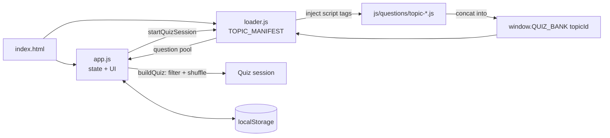

# Test-Prepare — QE-Fullstack Interview Practice

A static, no-build web project for preparing for QA / Full-Stack quality-engineering interviews. It contains a topic-based **practice quiz app** with thousands of multiple-choice questions, and a separate **50-question timed diagnostic mock exam**.

- **Quiz app:** `quiz-app/` — pick topics, difficulty, length and timer, then get instant feedback and explanations.
- **Mock exam:** `Mock_MCQs.html` — a single-file, 90-minute, 50-question diagnostic with a post-submission review.
- **Entry point:** the root `index.html` redirects to `quiz-app/`.

---

## Table of contents

- [Features](#features)
- [Topics covered](#topics-covered)
- [Prerequisites](#prerequisites)
- [Installation](#installation)
- [Running locally](#running-locally)
- [Usage](#usage)
- [Mock diagnostic exam](#mock-diagnostic-exam)
- [Project structure](#project-structure)
- [Architecture](#architecture)
- [Question data format](#question-data-format)
- [Adding questions](#adding-questions)
- [Deploying to GitHub Pages](#deploying-to-github-pages)
- [Known issues](#known-issues)
- [Contributing](#contributing)
- [License](#license)

---

## Features

- **Lazy loading** — only the question files for the topics you select are downloaded.
- **Topic, length and difficulty filters** — choose one topic, several, or all; 10 / 25 / 50 / 100 questions or a custom length; `beginner`, `intermediate`, `advanced` or all.
- **Optional per-question timer** — off, 30 s, 60 s or 90 s.
- **Explanations** — every question has an explanation shown after you answer.
- **Randomised order** — questions are shuffled using `crypto.getRandomValues` when available.
- **Bookmarks** — flag questions and run a quiz made only of bookmarked questions.
- **Session resume** — an in-progress quiz is saved and can be resumed.
- **High scores** — best score per topic and quiz length.
- **Results review** — per-question review at the end of a quiz.
- **Keyboard shortcuts** — see [Usage](#usage).
- **Swipe navigation** — swipe left/right on touch devices.
- **Light / dark theme** toggle.
- **No runtime dependencies** — plain HTML, CSS and vanilla JavaScript; no framework, bundler or backend.

---

## Topics covered

Counts below were obtained by loading every file in `quiz-app/js/questions/`.

| # | Topic | Topic id | Questions |
|---|-------|----------|-----------|
| 01 | Core Testing Fundamentals | `core-testing` | 420 |
| 02 | SQL & Database Fundamentals | `sql-db` | 380 |
| 03 | Java Fundamentals | `java` | 270 |
| 04 | JavaScript Fundamentals | `javascript` | 370 |
| 05 | Python Fundamentals | `python` | 420 |
| 06 | TestNG Fundamentals | `testng` | 420 |
| 07 | Mobile Testing Fundamentals | `mobile-testing` | 420 |
| 08 | API Testing / Postman | `api-postman` | 420 |
| 09 | Git & GitHub Fundamentals | `git-github` | 420 |
| 10 | Cucumber Fundamentals | `cucumber` | 420 |
| 11 | Selenium | `selenium` | 420 |
| 12 | Playwright | `playwright` | 420 |
| 13 | JUnit | `junit` | 210 (+200 not reachable, see [Known issues](#known-issues)) |
| 14 | Code Challenges | `code-challenges` | 830 |

**Total in the repository:** 6,040 questions (1,117 beginner, 3,571 intermediate, 1,352 advanced).
**Currently served by the app:** 5,840 questions (see [Known issues](#known-issues)).

---

## Prerequisites

- A modern evergreen browser (Chrome, Edge, Firefox, Safari).
- A way to serve static files over HTTP. Any one of:
  - [Python](https://www.python.org/) 3 (usually already installed), or
  - [Node.js](https://nodejs.org/) (current LTS) with `npx`, or
  - the VS Code *Live Server* extension.
- [Git](https://git-scm.com/) to clone the repository.

There is **no** `npm install`, build step, or package manifest.

---

## Installation

```bash
git clone https://github.com/MuhammadSulthanKM/Test-Prepare.git
cd Test-Prepare
```

---

## Running locally

> **Important:** the app loads question files by injecting `<script src="...">` tags at runtime. Opening `index.html` directly via `file://` is unreliable. Serve the folder over HTTP.

Bind the server to **localhost only** (`127.0.0.1`) so the files are not exposed to your network.

```bash
# Option 1 — Python (any OS)
python -m http.server 8080 --bind 127.0.0.1 --directory quiz-app
# open http://127.0.0.1:8080

# Option 2 — Node.js
npx http-server quiz-app -a 127.0.0.1 -p 8080
# open http://127.0.0.1:8080

# Option 3 — VS Code Live Server
# Right-click quiz-app/index.html -> "Open with Live Server"
```

To try the mock exam, serve the repository root and open `http://127.0.0.1:8080/Mock_MCQs.html`
(it is a self-contained file, so double-clicking it also works).

---

## Usage

### Taking a quiz

1. **Home screen** — choose a topic card, or **All topics** for a mixed quiz. You can also start from your **bookmarks** or **resume** a saved session.
2. **Config screen** — set quiz length (10 / 25 / 50 / 100 or custom), difficulty, and timer (off / 30 s / 60 s / 90 s), then start.
3. **Quiz screen** — answer each question. The correct option and an explanation are revealed immediately. Use **Skip**, **Prev**, **Next**, and the bookmark button as needed.
4. **Results screen** — see your score, review every question, restart, or return home.

### Keyboard shortcuts

| Key | Action |
|-----|--------|
| `1`–`4` or `A`–`D` | Select an answer option |
| `Enter`, `→`, or `N` | Next question |
| `←` | Previous question |

### Data stored in your browser

State is kept in `localStorage` only; nothing is sent to a server.

| Key | Purpose |
|-----|---------|
| `qe_theme` | Light / dark theme |
| `qe_bookmarks` | Bookmarked question ids |
| `qe_session` | Saved in-progress session |
| `qe_hiscores` | High scores per topic and length |

Clear these keys (or site data) to reset the app.

---

## Mock diagnostic exam

`Mock_MCQs.html` is an independent, single-file assessment:

- 50 multiple-choice questions, randomised on each attempt.
- 90-minute countdown; auto-submits when time expires.
- Explanations and a topic-level breakdown are shown only after submission.
- Uses a 15/50 (30%) score as its benchmark for the result message.

---

## Project structure

```
Test-Prepare/
├── index.html                  Redirects to quiz-app/
├── Mock_MCQs.html              Standalone 50-question timed diagnostic
├── README.md                   This file
└── quiz-app/
    ├── index.html              SPA shell + splash screen
    ├── _config.yml             Disables Jekyll theme/plugins for GitHub Pages
    ├── README.md               Older, quiz-app-level readme
    ├── css/
    │   └── style.css           Responsive, mobile-first styles (light/dark)
    └── js/
        ├── app.js              Quiz engine: state, rendering, timer, scoring, bookmarks, events
        ├── loader.js           Lazy chunk loader and TOPIC_MANIFEST
        └── questions/
            └── topic-NN-<name>-pK.js   Question parts (4 per topic; 14 for code-challenges)
```

---

## Architecture



- **`app.js`** holds a single `State` object and re-renders the `#app` container for each screen (`home`, `config`, `loading`, `quiz`, `results`, `bookmarks`). Clicks are handled through delegated `data-action` attributes.
- **`loader.js`** exposes `window.QuizLoader` (`loadTopics`, `loadTopic`, `TOPIC_MANIFEST`, `isPartLoaded`). It injects each part file once, in order, and resolves with the accumulated `window.QUIZ_BANK[topicId]` array. A missing part file logs a warning and is skipped rather than aborting the quiz.
- **Question parts** append to a shared registry, so several files can contribute to one topic.

---

## Question data format

Every question is a plain object:

```js
{
  id:          5042,             // globally unique number
  topic:       'junit',          // matches a TOPIC_MANIFEST key
  difficulty:  'intermediate',   // 'beginner' | 'intermediate' | 'advanced'
  question:    'What is …?',
  options:     ['A', 'B', 'C', 'D'],
  answer:      2,                // zero-based index of the correct option
  explanation: 'Why option C is correct …'
}
```

---

## Adding questions

1. Create a new part file, for example `quiz-app/js/questions/topic-13-junit-p5.js`.
2. Append to the registry using the **same topic id used in `TOPIC_MANIFEST`** — never overwrite the array:

   ```js
   window.QUIZ_BANK['junit'] = (window.QUIZ_BANK['junit'] || []).concat([
     { id: 6041, topic: 'junit', difficulty: 'beginner', question: '…',
       options: ['…', '…', '…', '…'], answer: 0, explanation: '…' },
   ]);
   ```

3. Register the file in `TOPIC_MANIFEST` in `quiz-app/js/loader.js`:

   ```js
   'junit': ['topic-13-junit-p1', 'topic-13-junit-p2', 'topic-13-junit-p3', 'topic-13-junit-p4', 'topic-13-junit-p5'],
   ```

4. Validate the syntax and registry key before committing:

   ```bash
   node -e "const fs=require('fs');global.window={QUIZ_BANK:{}};new Function('window',fs.readFileSync('quiz-app/js/questions/topic-13-junit-p5.js','utf8'))(window);console.log(Object.keys(window.QUIZ_BANK))"
   ```

To add a **new topic**, also add an entry to the `TOPICS` array in `quiz-app/js/app.js` (id, label, icon, colour, count) and to `TOPIC_MANIFEST` in `loader.js`.

---

## Deploying to GitHub Pages

1. Push the repository to GitHub.
2. Go to **Settings → Pages**.
3. Under *Source*, choose **Deploy from a branch**, branch `main`, folder `/ (root)`.
4. Save. The site is published at `https://<username>.github.io/<repo-name>/`, which redirects to `/quiz-app/`.

`quiz-app/_config.yml` (`plugins: []`, `theme: null`) keeps Jekyll from altering the static files.

---

## Known issues

These were found while documenting the project and are **not yet fixed**:

1. **200 JUnit questions are not served.** `topic-13-junit-p3.js` and `topic-13-junit-p4.js` append to `window.QUIZ_BANK['topic-13-junit']`, but the loader reads `window.QUIZ_BANK['junit']`. Only parts 1–2 (210 questions) reach the quiz. Fix: change the registry key in those two files to `'junit'`.
2. **Stale counts in the UI.** `quiz-app/index.html` advertises "4,170+" questions and 13 topics, the older `quiz-app/README.md` says "5,100+", and the `count` values in `TOPICS` (`app.js`) differ from the real numbers (for example Selenium is 210 there but 420 in the data).
3. **Fallback path is incomplete.** `collectLoadedQuestions()` in `app.js` reads globals such as `window.QUESTIONS_JUNIT`, which the part files do not define. It only matters if `loader.js` fails to load.

---

## Contributing

1. Fork the repository and create a feature branch.
2. Keep question ids unique and `answer` as a zero-based index into `options`.
3. Provide an `explanation` for every question and fact-check it against official documentation.
4. Run the validation snippet from [Adding questions](#adding-questions) before opening a pull request.

---

## License

The existing `quiz-app/README.md` states the project is released under the **MIT** license. No `LICENSE` file is present in the repository; add one to make the terms explicit.
